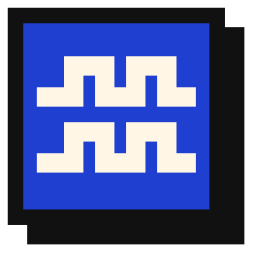
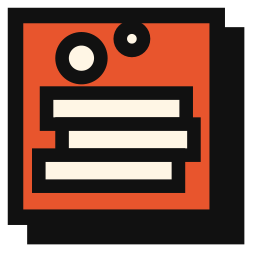
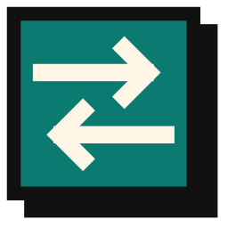
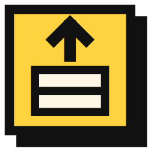
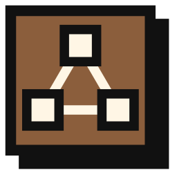
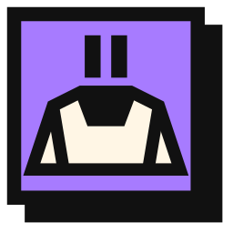
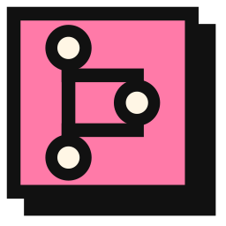
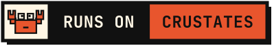
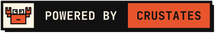

# Crustates brand kit

The crab logo, product icons, badges, banners and colours of [Crustates](https://crustates.eu).


## What's here

| Folder | Contents |
|---|---|
| `svg/` | Every asset as SVG: mark, logos, wordmarks, product icons, badges, emblems, banners, favicon, app icon, avatar |
| `png/` | PNG exports for places that can't use SVG (favicons, app icons, avatars, social images, badges) |
| `generator/` | `build_brand.py`, the script that draws everything from code, and the fonts it needs |

Download the latest kit as a zip from the [Releases page](https://github.com/crustates/brand/releases/latest).

## Product icons

| Tide | Reef | Current | Molt | Cast | Barnacle | Spawn |
|:---:|:---:|:---:|:---:|:---:|:---:|:---:|
|  |  |  |  |  |  |  |

## Badges

Show that your project runs on or integrates with Crustates:



```md
[](https://crustates.eu)
```



```md
[](https://crustates.eu)
```

More badges (products, open source, self-hosted) are in `svg/badge-*.svg`.

## Products and colours

| Name | Area | Colour | Text on it |
|---|---|---|---|
| Crustates | The platform | Rust `#E8552D` | ink |
| Tide | Compute | Blue `#1F3FD1` | cream |
| Reef | Storage | Rust `#E8552D` | ink |
| Current | Networking | Teal `#0B7A70` | cream |
| Molt | OS and upgrades | Yellow `#FFD23F` | ink |
| Cast | Clusters | Brown `#8B5E3C` | cream |
| Barnacle | Plugins | Violet `#A77BFF` | ink |
| Spawn | GitOps and deploys | Pink `#FF7AA8` | ink |
| Assistant | AI assistant | Green `#3DDC84` | ink |

Base colours: ink `#111111`, cream `#FFF6E5`. Fonts: Space Grotesk (headings and UI) and JetBrains Mono (code and labels).

## Regenerate

```sh
pip install -r generator/requirements.txt
python generator/build_brand.py generator/fonts out
```

CI checks that `svg/` matches the generator output, so change the code, not the SVGs. The reference is Linux: on macOS the two emblem SVGs can differ in the last digit of some coordinates.

## Using the brand

Write about Crustates, show the logo unmodified and add the badges to projects that run on it. Don't ship a fork or a product under the name or the crab. [TRADEMARK.md](TRADEMARK.md) has the details.

## Licence

The files are licensed under [CC BY 4.0](LICENSE). The name "Crustates" and the crab are trademarks: see [TRADEMARK.md](TRADEMARK.md). The fonts in `generator/fonts` are under the [SIL Open Font License 1.1](generator/fonts/OFL.txt).
