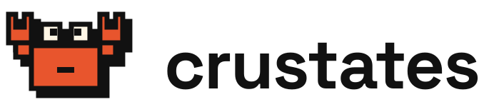

# Crustates brand kit

The crab logo, product icons, badges, banners and colours of [Crustates](https://crustates.eu).



## What's here

| Folder | Contents |
|---|---|
| `svg/` | Every asset as SVG: mark, logos, wordmarks, product icons, badges, emblems, banners, favicon, app icon, avatar |
| `png/` | PNG exports for places that can't use SVG (favicons, app icons, avatars, social images, badges) |
| `generator/` | `build_brand.py`, the script that draws everything from code, and the fonts it needs |

## Products and colours

| Name | Area | Colour | Text on it |
|---|---|---|---|
| Crustates | The platform | Rust `#E8552D` | ink |
| Tide | Compute | Blue `#1F3FD1` | cream |
| Reef | Storage | Rust `#E8552D` | ink |
| Current | Networking | Teal `#0B7A70` | cream |
| Molt | OS and upgrades | Yellow `#FFD23F` | ink |
| Cast | Clusters | Brown `#8B5E3C` | cream |
| Barnacle | Plugins | Violet `#A77BFF` | ink |
| Spawn | GitOps and deploys | Pink `#FF7AA8` | ink |
| Assistant | AI assistant | Green `#3DDC84` | ink |

Base colours: ink `#111111`, cream `#FFF6E5`. Fonts: Space Grotesk (headings and UI) and JetBrains Mono (code and labels).

## Regenerate

```sh
pip install cairosvg uharfbuzz fonttools
python generator/build_brand.py generator/fonts out
```

## Licence and use

The files are licensed under [CC BY 4.0](LICENSE). The name "Crustates" and the crab are trademarks: see [TRADEMARK.md](TRADEMARK.md) for what that means in practice. The fonts in `generator/fonts` are under the SIL Open Font License 1.1.
